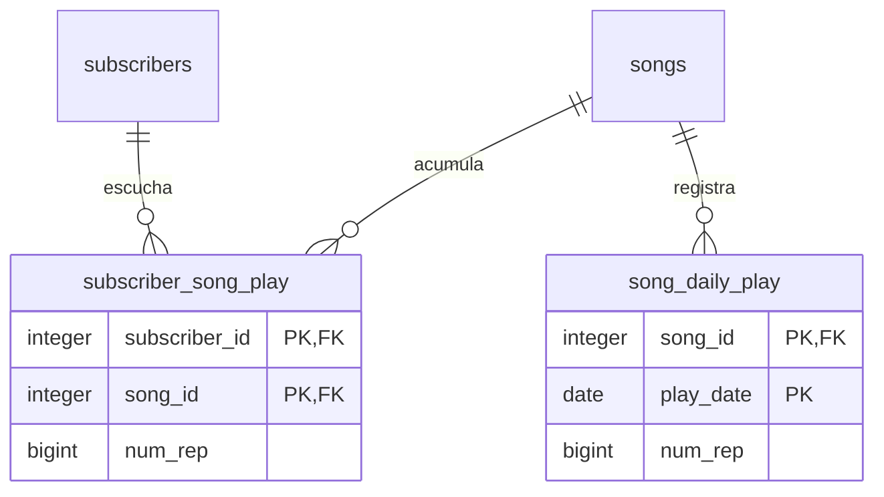

# Tablas de reproducción

La primera tabla guarda conteos históricos por usuario y canción; la segunda conserva el total diario por canción en UTC. Los eventos individuales permanecen en archivos, fuera de PostgreSQL.
